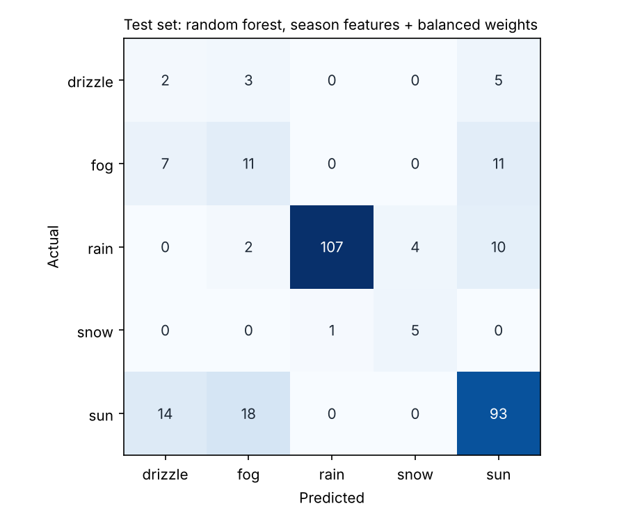
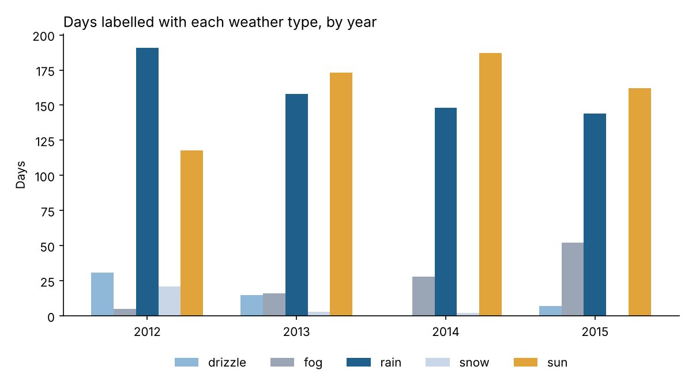
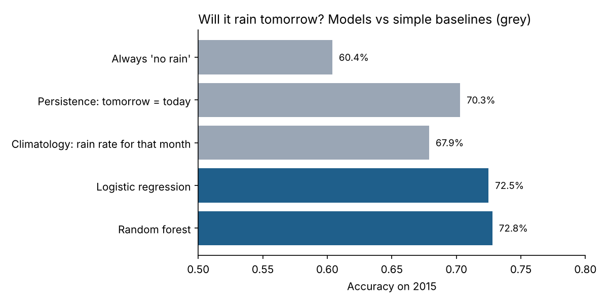

# Seattle Weather: Classification vs Real Forecasting


Four years of daily Seattle weather (2012–2015, 1,461 days) used to answer two questions:

1. **Classification:** given today's measurements, what type of weather was it? (rain, sun, fog, drizzle or snow)
2. **Forecasting:** given everything known by tonight, will it rain tomorrow?

My [first version](notebooks/01_original_notebook.ipynb) of this project reached **80.9% accuracy** with a tuned XGBoost model. This repo checks whether that number means what it seems to.

## Part 1: The 81% model is matched by a two-line rule

Every rain and snow day in the data has precipitation recorded, and every sun, fog and drizzle day has exactly zero. So "if there was precipitation it rained, otherwise it was sunny" is almost the whole task. On the same test split as the original notebook:

| Model | Accuracy | Macro F1 | Fog caught | Drizzle caught | Snow caught |
|---|---|---|---|---|---|
| Always predict the most common type | 42.0% | 0.12 | 0% | 0% | 0% |
| **Precipitation rule (no machine learning)** | **81.2%** | 0.45 | 0% | 0% | 33% |
| XGBoost, original settings | 75.8% | 0.47 | 14% | 0% | 33% |
| XGBoost, original grid search | 80.9% | 0.47 | 3% | 0% | 33% |
| XGBoost, season features + balanced weights | 75.1% | **0.58** | 38% | 40% | 50% |
| Random forest, season features + balanced weights | 74.4% | 0.57 | 38% | 20% | 83% |

*The original-settings row scored 76.8% in my first notebook; the small difference comes from a newer XGBoost version. Test set: 293 days (125 sun, 123 rain, 29 fog, 10 drizzle, 6 snow). Macro F1 averages the score across all five weather types equally, so rare types count as much as common ones.*

**What this shows:**
- **Accuracy was the wrong measure.** Rain and sun make up 85% of days, so a model can score 81% while barely recognising the rare types. The original tuned model caught 1 of the 29 fog days and none of the 10 drizzle days.
- **Weighting the rare types up** and adding the time of year (two-thirds of fog days fall between September and January) helps the models catch rare types: the random forest finds 83% of snow days, and the rebalanced XGBoost finds 40% of drizzle and 38% of fog. Overall accuracy falls to about 75%, but macro F1 rises from 0.47 to 0.58. Which one matters depends on the use: a fog warning system would want the second model.
- **Fog and drizzle can't be told apart reliably** from these four measurements. Both have zero precipitation and similar temperatures.



### The labels themselves change over time



Fog days rise from 5 in 2012 to 52 in 2015, while drizzle drops from 31 to 0 in 2014. Seattle's climate didn't change that fast, so this looks like a change in how days were labelled. That limits how well any model can learn these two types, and it's worth checking with whoever owns the data before trusting them.

## Part 2: A real forecast for tomorrow

Part 1 classifies a day using that same day's measurements, which is not a forecast. Here the model only sees what is known by the end of today (today's and the previous two days' weather, 3- and 7-day rainfall totals, and the time of year). It must predict whether tomorrow will be wet.

To mimic real use, the models train on **2012–2014** and are tested on **2015**, a year they have never seen. A random split would let the model learn from days on either side of each test day.



| Model | Accuracy | F1 (rain) | ROC AUC | Brier score (lower is better) |
|---|---|---|---|---|
| Always "no rain" | 60.4% | 0.00 | | 0.396 |
| Persistence: tomorrow = today | 70.3% | 0.63 | | 0.297 |
| Climatology: rain rate for that month | 67.9% | 0.67 | 0.727 | 0.204 |
| Logistic regression | 72.5% | 0.64 | 0.785 | 0.184 |
| Random forest | 72.8% | 0.65 | 0.785 | 0.183 |
| XGBoost | 71.7% | 0.63 | 0.755 | 0.200 |

**What this shows:** the models beat every simple baseline, but only by a few points. "Tomorrow will be like today" is already right 70% of the time. With four basic measurements and no air pressure, humidity or cloud data, that's about as far as daily forecasting can go. Real forecasters use far richer data. Simple logistic regression does as well as the random forest, and XGBoost does slightly worse (71.7%). So logistic regression would be the sensible choice here: it's faster, and easier to explain.

## What I changed from the first version

| First version | Now |
|---|---|
| Judged on accuracy only | Macro F1 and per-type recall reported, so rare types aren't hidden |
| No baseline to compare against | Compared with simple rules, which turned out to match the model |
| Scaled with the whole dataset's maximum before splitting | No scaling needed for tree models; logistic regression scales inside a pipeline fitted on training data only |
| Grid search tuned for accuracy | Tuned for macro F1, with rare types weighted up |
| Called a "prediction" but used same-day data | Split into same-day classification and a genuine next-day forecast with a time-based split |

## Run it yourself

```bash
git clone https://github.com/ranzith1282000-beep/seattle-weather-ML.git
cd seattle-weather-ML
pip install -r requirements.txt
python src/classify_today.py      # Part 1 tables and charts
python src/forecast_tomorrow.py   # Part 2 tables and charts
pytest                            # 5 tests
```

The tests check for the mistakes that make models look better than they are. They confirm that forecast features only use past data (changing future values must not change earlier features), that the target really is the next day, and that training and test years don't overlap.

## Repository layout

```
├── src/features.py           data loading, season and lag features
├── src/classify_today.py     Part 1
├── src/forecast_tomorrow.py  Part 2
├── src/models.py             shared model settings
├── tests/test_weather.py     leakage and split checks
├── data/seattle-weather.csv  1,461 days, 2012–2015
├── results/                  tables written by the scripts
├── images/                   charts written by the scripts
└── notebooks/01_original_notebook.ipynb   my first version
```

## Tools

Python, pandas, scikit-learn, XGBoost, Matplotlib, pytest, GitHub Actions

Data: the Seattle daily weather dataset (2012–2015) shared on Kaggle.
